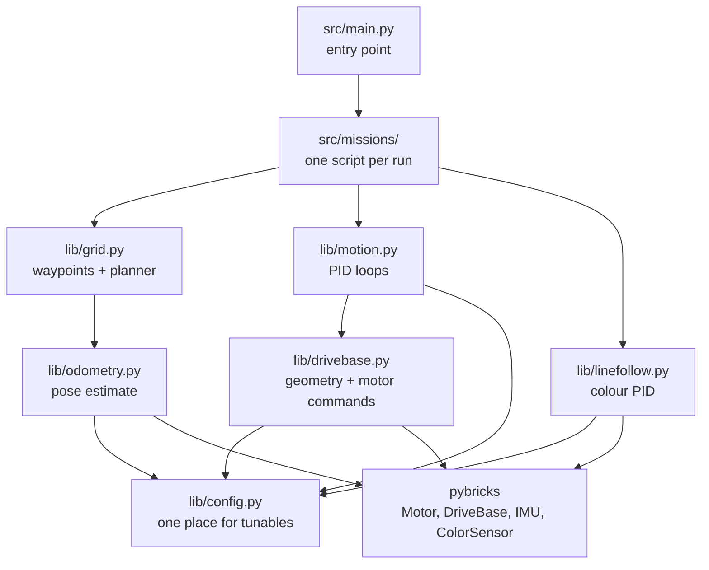

# Robot Overview

Map of the robot and of the code that drives it. This note owns the **shape** of the system,
not the tuning values.

## Responsibility

- Define which subsystem owns which decision.
- Keep one source of truth for the module layout.
- Point to the maintained note for each subsystem.

## Source and evidence

- Source: `src/` (scaffold only at time of writing), `src/sim/`, `tests/`
- Context: repository review; **no hub run**
- Evidence: proposal, plus filesystem facts
- Verified: not yet

## Layout

## Subsystems

| Note | Owns |
| --- | --- |
| [[docs/Systems/Drive Base\|Drive base]] | Wheel geometry, motor polarity, straight/turn/arc primitives |
| [[docs/Systems/Motion Control\|Motion control]] | PID loops for distance, heading, and turns |
| [[docs/Systems/Odometry and Localization\|Odometry]] | Pose `(x, y, θ)` from encoders and gyro |
| [[docs/Systems/Connected Grid\|Connected grid]] | Field coordinates, waypoint graph, path planning |
| [[docs/Systems/Line Following\|Line following]] | Colour-sensor tracking for the line event |

## Design rules

1. **One place converts units.** `config.py` holds wheel diameter, track width, gear ratio.
   Nothing else divides by 360 or by a gear ratio.
2. **Pure maths never imports `pybricks`.** PID, geometry, and planning live in importable
   modules so `tests/` can run on a laptop.
3. **Hardware wrappers stay thin.** `drivebase.py` is allowed to touch `Motor`; `motion.py` is
   not.
4. **No loop fights another.** If the built-in `DriveBase` heading controller is active, our
   heading PID must not also try to control the same motors.
5. **Every tunable is labelled** `measured`, `datasheet`, or `guessed` in `config.py`.

## Hardware

Not yet recorded. Fill in [[docs/Guides/Agent Quickstart]] first; this note should not guess
ports or wheel sizes.

## Validation

- Offline: layout reviewed against the repository.
- Hub: **not run — no hub connected**.

## Related

- [[docs/Home|Home]]
- [[docs/Guides/Agent Quickstart|Agent quickstart]]
- [[docs/Code Style|Code style]]
